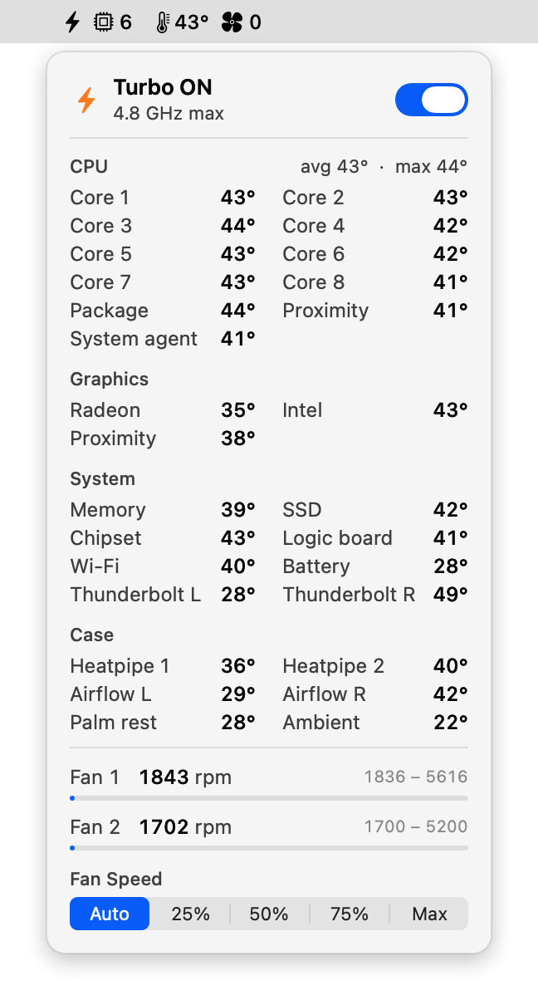

# TurboBar

A tiny menu bar app for Intel Macs that shows CPU load, CPU temperature and fan speed, caps Turbo Boost with one switch, and lets you set the fans by hand.

<picture>
  <source media="(prefers-color-scheme: dark)" srcset="docs/menu-dark.png">
  
</picture>

## Why

Intel MacBooks run hot and loud under Turbo Boost. Switching Turbo off directly takes a kernel extension, which recent macOS won't load without lowering system security. TurboBar needs neither. It caps Turbo by switching on macOS Low Power Mode, which on the i9-9880H it was built on holds the CPU at 2.6 GHz instead of letting it boost to 4.8 GHz.

## Features

**In the menu bar:** whether Turbo is on, CPU load, the average temperature of the CPU cores, and fan speed (0 is idle, 100 is flat out).

**In the menu:**
- A Turbo switch, with the current clock limit
- Every temperature sensor the Mac reports that has a known name: each CPU core, package, integrated and discrete GPU, memory, SSD, chipset, battery, Thunderbolt, heatpipes, airflow and more. Readings turn orange from 80 °C and red from 90 °C.
- Speed of each fan, and a manual fan speed: Auto, 25%, 50%, 75% or Max

**Light on resources:** it reads every 3 seconds, stops while the display sleeps and redraws only when a number changes by 2 or more. Running, it uses about 0.1% of one CPU core.

## Requirements

- An Intel Mac. Apple Silicon Macs aren't supported: they have no Turbo Boost, and their sensors are named differently.
- macOS 13 or later. Built and tested on a 16-inch MacBook Pro (2019) running macOS 26.
- The Xcode Command Line Tools, to build it (`xcode-select --install`).

## Build and install

```sh
git clone https://github.com/TMinusNine/TurboBar.git
cd TurboBar
./build.sh
cp -R TurboBar.app /Applications/
open /Applications/TurboBar.app
```

To start it at login, add it in System Settings → General → Login Items (called Login Items & Extensions on macOS 15 and later).

Because you build it yourself, macOS doesn't quarantine it, so there's no "unidentified developer" warning.

## How it works

- **Turbo:** the switch runs `pmset -a lowpowermode`, which asks for your administrator password. The state and clock limit come from the `machdep.xcpm` kernel settings.
- **Readings:** CPU load comes from the kernel's host statistics. Temperatures and fan speeds are read from the System Management Controller (SMC), which needs no special rights.
- **Fan control:** setting fan speeds needs root, so TurboBar starts a small helper, `turbofan`, with your administrator password, and only while a manual speed is selected. The helper hands the fans back to macOS when you choose Auto, when TurboBar quits or crashes, or if the CPU or GPU reaches 90 °C at a reduced speed. Nothing runs as root in Auto.

## Caveats

- Manual fan control writes to the SMC. It has only been used on one Mac model, so use it at your own risk.
- Apple doesn't document SMC sensor names. The labels come from community research, and a few are best guesses.

## Uninstall

Choose Quit TurboBar from its menu, remove it from Login Items if you added it, and delete `/Applications/TurboBar.app`.

## License

[MIT](LICENSE)
